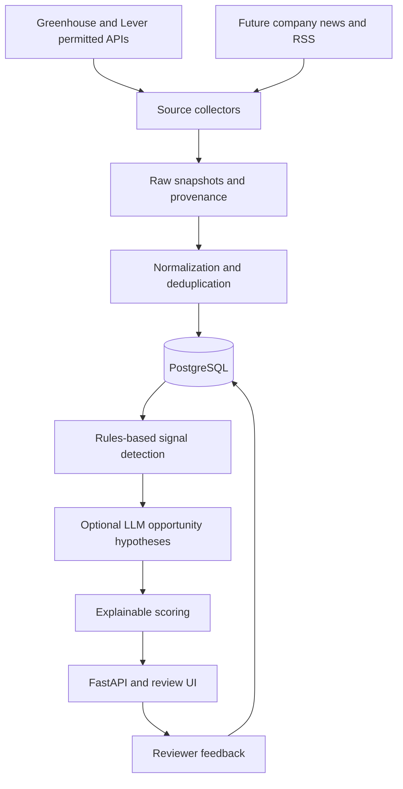

# Architecture V1

## Logical flow



## Current implementation and next milestone
Greenhouse and Lever collectors, PostgreSQL persistence and change detection form the initial implementation baseline. **Next: manually execute a real Greenhouse end-to-end dry run** before adding signal intelligence. Do not treat a successful unit or integration test as proof of live-source correctness.

### Greenhouse end-to-end verification
1. Select a publicly accessible Greenhouse board whose API usage is permitted; document board identifier, access rules and run time. Do not commit credentials or personal data.
2. Start PostgreSQL using the existing local setup and apply the current schema/migrations.
3. Run the collector manually and inspect source provenance, company mapping, record counts, timestamps and content fingerprints.
4. Run the same collector again against unchanged data. Verify idempotency: no duplicate records or spurious change events.
5. Validate the change-detection path with a controlled fixture or a genuinely changed posting. Check new, changed and removed/unavailable cases separately; do not equate a transient fetch failure with a deletion.
6. Record commands, environment prerequisites, observed counts, failures and limitations in a reproducible test report. Use only safe, non-sensitive examples.

**Gate to proceed:** repeatable collection and persistence, verified no-op second run, meaningful change detection, clear failure logging and documented source permissions.

## Proposed components
- **Collectors (Python):** source adapters, incremental fetch, throttling, retry, manual invocation initially and source-specific terms-of-use controls.
- **Storage (PostgreSQL):** companies, source records, snapshots, signals, hypotheses, evidence links, scores and reviewer decisions. Preserve source provenance and first/last-seen timestamps.
- **Change detection:** compare normalized fingerprints and record lifecycle across runs; retain snapshots and distinguish source unavailability from true removal.
- **Signal engine (next vertical slice):** deterministic rules over job title, description, technologies, seniority and hiring patterns; cluster by company and time window. Categories: platform engineering, cloud, DevOps, modernization, architecture and AI engineering. Every signal points to source records and has an explainable reason.
- **LLM adapter (after baseline):** optional hosted or local inference, structured JSON, schema validation and model/version tracking. Never invent facts absent from evidence.
- **Scoring:** keep evidence confidence, consulting relevance and commercial priority separate. Hiring is not confirmed buying intent.
- **API (FastAPI):** read-only opportunity endpoints and reviewer feedback when the pipeline is proven.
- **UI:** optional React dashboard after evaluation.
- **Orchestration:** manual jobs for the PoC; scheduling later, with idempotency and observable logs.

## Suggested repository layout
```text
apps/api/
apps/web/
packages/collectors/
packages/signals/
packages/intelligence/
packages/llm/
infra/docker/
tests/
docs/
```

## Minimum data model
- Company: canonical name, domain, aliases, country
- SourceRecord: URL, source, retrieval time, publication time, rights/retention metadata
- Snapshot: content fingerprint, observed-at timestamp, normalized content
- Signal: company, category, evidence record IDs, first/last seen, confidence, explanation
- Opportunity: hypothesis, supporting and contradicting evidence, model/version, confidence and priority scores, status
- Review: reviewer, decision, notes, timestamp

## Operational safeguards
Respect source terms, robots.txt where applicable, rate limits and licensing; prefer permitted APIs. Minimize personal data and define retention/deletion rules. Never commit secrets, private sales assessments or internal customer intelligence. Track crawl failures and evidence freshness. Do not redistribute restricted source content.

## Deployment
Local Docker Compose for PostgreSQL, API and workers. Hosted LLMs initially; local inference via provider-neutral adapter later. Authentication and network restrictions are required before exposing a review UI beyond trusted development environments.
