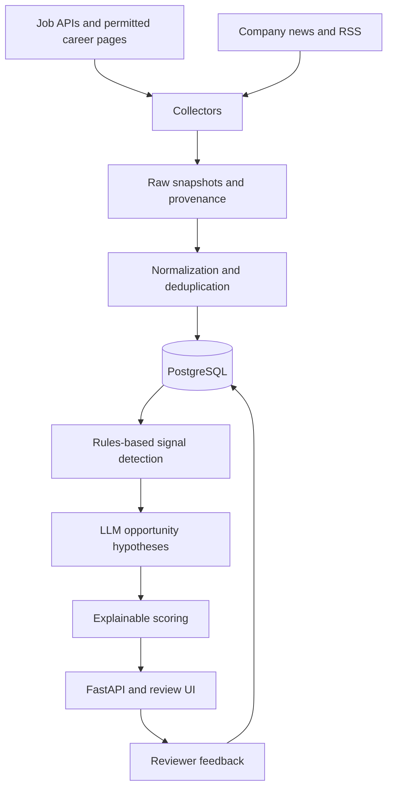

# Architecture V1

## Logical flow



## Proposed components
- **Collectors (Python):** per-source adapters, incremental fetch, throttling, retry and source-specific terms-of-use controls.
- **Storage (PostgreSQL):** companies, source records, snapshots, signals, hypotheses, evidence links, scores and reviewer decisions. Preserve timestamps and source provenance.
- **Signal engine:** deterministic extraction and classification first; cluster related postings by company and time window.
- **LLM adapter:** configurable hosted or local inference with structured JSON output, model/version tracking and schema validation.
- **Scoring:** separate evidence confidence, estimated relevance and commercial priority. A job posting is an indicator, not confirmed buyer intent.
- **API (FastAPI):** read-only opportunity endpoints and reviewer feedback.
- **UI:** simple React dashboard only after pipeline validation.
- **Orchestration:** scheduled Python jobs with idempotent processing and observable execution logs.

## Suggested repository layout
```text
apps/api/
apps/web/
packages/collectors/
packages/signals/
packages/intelligence/
packages/llm/
infra/docker/
tests/
docs/
```

## Minimum data model
- Company: canonical name, domain, aliases, country
- SourceRecord: URL, source, retrieval time, publication time, rights/retention metadata
- Snapshot: content fingerprint, observed-at timestamp, normalized content
- Signal: company, category, evidence record IDs, first/last seen, confidence
- Opportunity: hypothesis, supporting and contradicting evidence, model/version, scores, status
- Review: reviewer, decision, notes, timestamp

## Operational safeguards
Respect robots.txt where applicable, site terms, rate limits and licensing; prefer licensed APIs and feeds. Store minimal personal data and define retention/deletion rules. Never commit secrets or internal customer intelligence. Keep API keys in environment variables. Track crawl failures and evidence freshness. Do not redistribute restricted source content.

## Deployment
Local Docker Compose for PostgreSQL, API and workers. Hosted LLMs initially; local inference via a provider-neutral adapter later. Authentication and network restrictions are required before exposing the review UI outside a trusted development environment.
